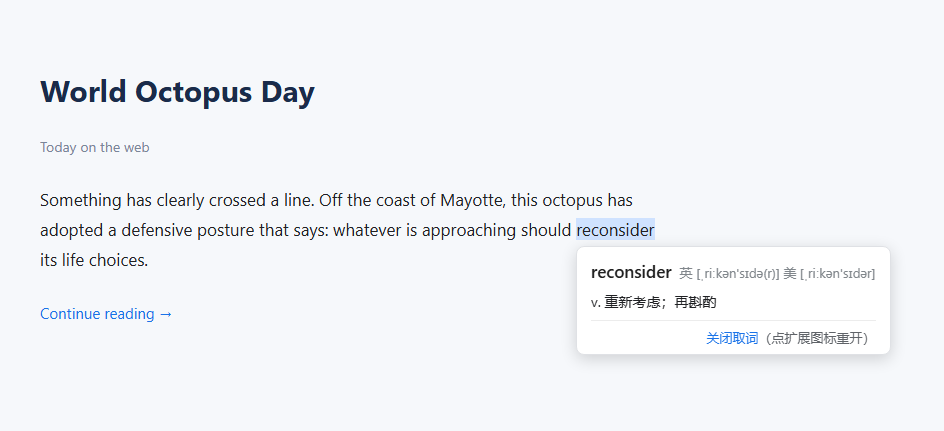

# Word Lookup Translator

Hover an English word on any web page and get a compact, Bing-style card with
British/American IPA and Chinese definitions — powered by [dict.cn](https://dict.cn).



> 中文说明见下方 [中文](#中文说明)。

## Features

- **Hover to look up** — a small card with the headword, 英/美 IPA, and
  part-of-speech + Chinese glosses (e.g. `v. 重新考虑；再斟酌`).
- **Word-level highlight** using the CSS Custom Highlight API — it never
  mutates the page DOM.
- **取词 on/off toggle** — click `关闭取词` in the card, or click the toolbar
  icon to switch it back on (the badge shows `OFF` when disabled).
- **No tracking, no accounts.** The extension only talks to `dict.cn`.

## Install (unpacked)

1. Clone or download this repository.
2. Open `chrome://extensions` and enable **Developer mode**.
3. Click **Load unpacked** and select the repository folder.
4. Hover any English word on a page.

## Usage

- Hover a word for ~0.25 s → the card appears. Move away to dismiss.
- Click `关闭取词` to disable. Click the **extension toolbar icon** to toggle it
  back on.

## How it works

| Part | Responsibility |
|------|----------------|
| `content_scripts/content_script.js` | Finds the word under the cursor, highlights it (CSS Custom Highlight API), renders the card |
| `background/background.js` | Service worker: fetches `https://dict.cn/<word>` and caches results (content scripts can't fetch dict.cn directly — no CORS headers) |
| `background/dict_parser.js` | Parses dict.cn's server-rendered HTML into `{ headword, pronunciations, basicTranslations }` |
| `ui/*.css` | Card and highlight styling |

Word text is normalized before lookup: soft hyphens and zero-width characters
are stripped, and curly apostrophes are folded to `'`, so words that pages
splice invisible characters into still resolve.

## Permissions & privacy

- `storage` — remembers the 取词 on/off state.
- `https://dict.cn/*` — required to fetch definitions.

There is no analytics and no data collection. The only network request is the
hovered word sent to dict.cn.

## Limitations

- dict.cn is an **English → Chinese** dictionary; non-English text is not looked up.
- Contractions (`don't`, `it's`) and some proper nouns have no dict.cn entry, so
  they show `未找到释义`.
- Depends on dict.cn's HTML structure; a markup change there would require a
  parser update.

## Development

```
background/
  background.js      # service worker: fetch + cache + message + toggle
  dict_parser.js     # dict.cn HTML -> data (pure, unit-tested)
content_scripts/
  content_script.js  # hover detection, highlight, card rendering
ui/                  # card + highlight CSS
test/parser.test.mjs # parser self-check
test_page.html       # manual test page
```

```bash
npm test   # runs the dict.cn parser self-check
```

> **After editing files, click Reload in `chrome://extensions`.** Chrome keeps a
> cached copy of an unpacked extension's service worker; a browser restart alone
> may not pick up your changes, which causes the content script and background
> to disagree (e.g. every lookup shows `未找到释义`).

## License

[MIT](LICENSE)

---

## 中文说明

**单词取词翻译** —— 在任意网页上悬停英文单词，弹出类似必应取词的卡片，显示
英式/美式音标和中文释义（数据来自 [海词 dict.cn](https://dict.cn)）。

### 功能

- **悬停查词**：卡片显示单词、英/美音标、词性 + 中文释义（如 `v. 重新考虑；再斟酌`）。
- **单词级高亮**：使用 CSS Custom Highlight API，不改动页面 DOM。
- **取词开关**：点卡片里的 `关闭取词` 关闭；点工具栏图标重新开启（关闭时图标显示 `OFF`）。
- **无追踪、无账号**，只访问 dict.cn。

### 安装（开发者模式）

1. 克隆或下载本仓库。
2. 打开 `chrome://extensions`，开启右上角**开发者模式**。
3. 点**加载已解压的扩展程序**，选择本仓库目录。
4. 在网页上悬停英文单词即可。

### 使用

- 悬停约 0.25 秒弹出卡片，移开即消失。
- 点 `关闭取词` 关闭；点**扩展工具栏图标**重新开启。

### 说明

- 仅支持英文单词（dict.cn 是英汉词典）。
- `don't`、`it's` 等缩写以及部分专有名词在 dict.cn 没有词条，会显示 `未找到释义`。
- 取词前会清理单词里的软连字符 / 零宽字符，并把弯引号 `’` 归一为 `'`。
- 修改文件后请在 `chrome://extensions` 点 **Reload**，否则 Chrome 可能仍用缓存的
  service worker，导致前后台不一致（表现为一直显示"未找到释义"）。

### 许可

[MIT](LICENSE)
